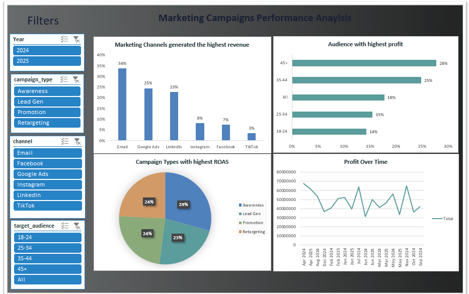

Marketing Campaigns Performance Analysis Dashboard

📌 Project Overview

This project focuses on analyzing marketing campaign performance using Microsoft Excel. The goal is to evaluate campaign profitability, compare marketing channels, and understand audience performance through an interactive dashboard.

📊 Dataset

The dataset contains 800 marketing campaign records across 2024 and 2025.

Key fields include:

Campaign ID

Launch Date

Marketing Channel

Campaign Type

Target Audience

Impressions

Clicks

Conversions

Campaign Spend

Revenue

Profit

🛠️ Tools & Techniques

Microsoft Excel

Pivot Tables

Pivot Charts

Slicers

Excel Formulas

Data Visualization

📈 Key Insights & Analysis

Marketing channel profitability analysis.

Campaign type performance comparison.

Profit contribution by target audience.

Profit trends over time.

Interactive filtering by year, campaign type, channel, and target audience.

📷 Dashboard Preview

🎯 Project Objectives

Evaluate marketing campaign profitability.

Identify high-performing marketing channels.

Analyze audience segments.

Support data-driven marketing decisions.

👨‍💻 Author

Mohamed Reda

Aspiring Data Analyst
